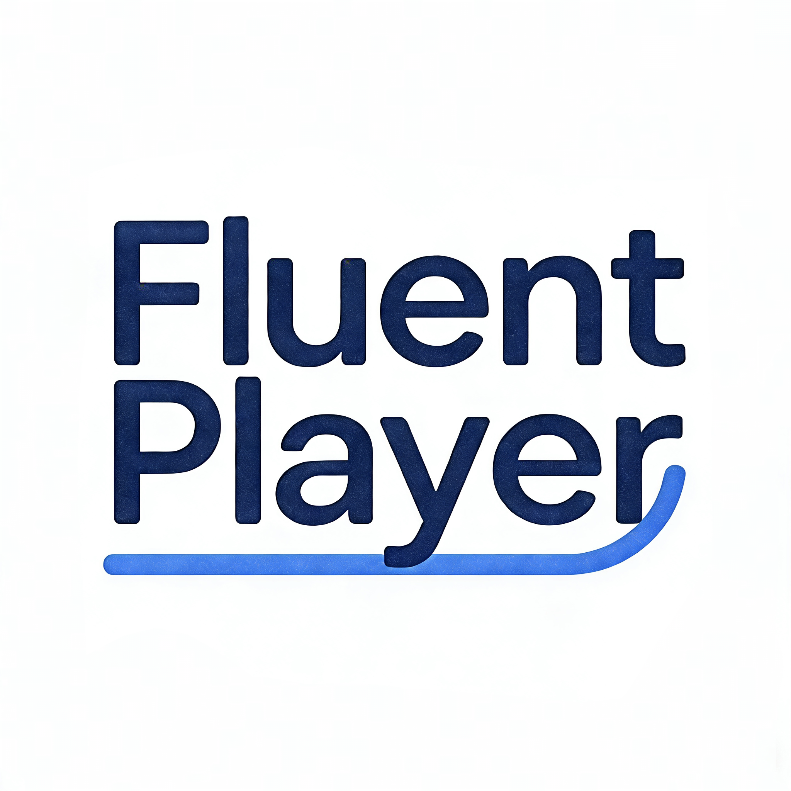

<p align="center">
  
</p>

<h1 align="center">Fluent Player</h1>
<p align="center">播放、阅读、整理，让视频与音频成为自己的学习资料。</p>
<p align="center">
  <a href="https://github.com/t66666t/Fluent-Player/releases">下载与发行版</a> ·
  <a href="docs/installation.md">安装指南</a> ·
  <a href="docs/user-guide.md">使用手册</a> ·
  <a href="docs/podcasts.md">播客</a> ·
  <a href="LICENSE">开源许可</a>
</p>

Fluent Player 是基于 Flutter 的媒体播放器与学习工具：导入本地视频和音频，订阅播客，一边播放一边阅读、整理字幕和笔记，也可以按需使用转录、翻译与 AI 辅助学习。

本仓库是 **Fluent Player 社区版**的源码，采用 GPL-3.0-or-later；**Fluent Player Pro** 是独立维护的闭源完整版。下文同时介绍两个版本，具体功能、平台及安装包以对应版本的实际发布说明为准。

## 选择适合你的版本

| 能力 | Fluent Player 社区版 | Fluent Player Pro 完整版 |
| --- | --- | --- |
| 源代码 | 本仓库开源，GPL-3.0-or-later | 闭源，独立维护 |
| 本地视频、音频、媒体库与批量导入 | 支持 | 支持 |
| 字幕阅读与编辑、语音转录、OCR、翻译和 AI 学习 | 支持 | 支持 |
| 发布者 RSS/Atom 播客 | 支持 | 支持 |
| 媒体整理、导出与设备同步 | 支持，受媒体来源和平台限制 | 支持，受媒体来源和平台限制 |
| Bilibili 播放、下载、字幕与弹幕 | 不提供 | 支持，取决于内容及账号权限 |
| YouTube / yt-dlp、抖音及网页媒体工具 | 不提供 | 提供相关下载和网页媒体工具，取决于来源支持 |
| 网盘与网页媒体入口 | 不提供 | 提供网盘及网页媒体入口，具体能力依服务而异 |

社区版并非完全离线：模型和字体下载、用户配置的 AI / 翻译 / 转录服务、播客以及用户启用的设备同步仍可联网。在线服务的可用性、权限和费用由各服务决定。两版使用独立应用身份和数据目录；Android 可同时安装，迁移数据请使用应用提供的导出或同步功能并留意各功能的适用范围。

## 下载与开始使用

计划在 [GitHub Releases](https://github.com/t66666t/Fluent-Player/releases) 提供社区版和 Pro 的安装包。打开具体版本的 **Assets**，根据文件名和发布说明选择版本、系统与处理器架构；实际附件以该 Release 为准。`Source code` 压缩包是源码，不能直接作为安装包使用。安装和升级前的数据备份方法见 [安装指南](docs/installation.md)。

1. 安装后导入本地视频或音频，或在播客入口订阅 RSS/Atom 节目。
2. 选择已有字幕，或按需配置本地模型、获授权的转录和翻译服务。
3. 在字幕侧栏逐句阅读、跳转或使用文章模式；需要时配置自己的 AI 服务进行问答。
4. 整理好的本地媒体和资料可按需导出或同步；请先核对应用中的范围说明。

本地播放不要求配置 AI；本地模型需要额外存储和算力。使用云服务时，相关内容会发送给所选择的服务商，可能需要账号、密钥或付费。

## 功能亮点

- **播放与媒体库**：导入视频、音频、文件夹、压缩包及配对字幕；按文件夹整理，继续上次播放，使用队列、倍速、章节、定时暂停和音乐歌词。
- **字幕与学习**：主副字幕同屏、逐句跳转、文章阅读、编辑、偏移调整、导出与笔记；可通过语音转录或 OCR 生成字幕。
- **翻译与字幕优化**：选择合适的本地模型或服务进行翻译；可单独启用 AI 字幕优化并编辑提示词，帮助整理识别结果。详见 [字幕优化](docs/subtitle-optimization.md) 与 [模型中心](docs/model-center.md)。
- **AI 对话与外部连接**：配置 AI 服务，围绕字幕提问或总结。桌面端可授权外部 AI 读取指定资料，也可另行授权管理转录及字幕；媒体文件不会通过该连接提供。详见 [外部 AI 连接](docs/external-ai.md)。
- **播客**：订阅发布者 RSS/Atom，浏览和搜索节目、管理队列与进度、离线收听及阅读文字稿；支持 OPML 等备份格式。详见 [播客说明](docs/podcasts.md)。
- **导出与迁移**：对符合条件的本地媒体合成字幕、导出文件或使用 FluentPack 整理迁移；也可通过设备同步保留进度与资料。
- **Pro 在线媒体**：浏览与处理 Bilibili 内容、使用 yt-dlp 和网页媒体及抖音工具、连接网盘；可用内容受平台、账号和接口变化影响。

网络来源媒体的导出和同步有额外限制：Pro 的部分网络下载与缓存只供本设备、本应用使用。社区版播客的 FluentPack 备份可选包含完整离线节目，默认关闭；单独导出播客卡片使用引用。保存、迁移或分享节目时，请遵守发布者的授权和适用规则。

## 功能范围

社区版提供**本地媒体、RSS 播客播放与学习**，沿用现有播放器和媒体库布局。

- 本地视频、音频、媒体库、播放进度、横竖屏播放和快捷键。
- 字幕/文稿、笔记、转录、OCR、翻译和 AI 学习。
- “批量导入”已恢复，可从侧栏、导入菜单或更多菜单进入，批量选择媒体及对应字幕；从文件夹打开时保留导入目标。
- 本地文件合成、导出、分享、打开文件位置和设备同步。

主界面提供“继续学习／文件夹／最近添加／播客”。播客包含订阅总览、频道、搜索与导入、节目预览、播放及设置页面，支持发布者 RSS/Atom、Apple Podcasts 目录、可选 Podcast Index、OPML/JSON/FluentPack 备份、队列、进度、收藏、离线下载、文字稿与原有转录学习流程。网页仅发现明确提供的 RSS，不提取网页隐藏媒体或绕过付费登录；公开 RSS 不等于允许再分发内容。详见 [播客说明](docs/podcasts.md)。

哔哩哔哩、YouTube、普通网页在线播放、内置浏览器和网盘入口继续停用；不监听网站剪贴板。旧网盘或网站播放、下载任务不会自动恢复。已有本地文件、字幕、笔记、进度和历史来源信息保留。

网站媒体直链提取、抖音下载、yt-dlp、网页嗅探与 AES 密钥提取保持移除。模型/字体资源获取、用户配置的获授权转录/翻译/AI 服务、更新检查和用户启用的设备同步继续保留；在线转录服务的可用性与授权以服务方和应用内提示为准。详见 [隐私与联网说明](PRIVACY.md)。帮助及 AI 回复中的参考链接仅在用户主动点击时交给系统查看，不作为媒体播放入口。

优先检查 Android、Windows，本地播放器继续保留 iOS、macOS、Linux 支持。每轮实际验证的平台与限制见 [社区版验证记录](docs/community-verification.md)。源码不依赖 WebView/WebView2/WPE；未参与构建的历史 Windows 插件补丁保留在第三方目录中。

## 体积和构建

源码不附带模型权重、各平台构建缓存、预编译原生库、下载器或签名密钥。保留模型清单、固定版本及构建脚本。
界面使用思源黑体可变字重版，并保留完整 CJK 字符后备；字幕默认使用狮尾圆体。少量体积较小的英文字体继续内置。思源宋体可从字体选择页的推荐列表下载，安装前相关预设使用思源黑体。旧 MiSans 与思源宋体字幕选择回退到思源黑体；用户导入的字体保持不变。

```sh
flutter pub get
python tool/verify_community_project.py
python tool/verify_model_integration.py
flutter analyze --no-pub
```

网络安全测试需要本机 OpenSSL；测试会临时生成证书和密钥，并在结束后清理。Windows 上也可使用 Git for Windows 自带的 OpenSSL。

Windows 的独立 FFmpeg/ONNX 输入可显式执行 `python tool/prepare_release_assets.py --platform windows` 准备。
ASR/OCR/翻译原生扩展按 `docs/model-integration.md` 构建；模型权重沿用模型中心按需获取。缺少原生构建输入时，源码静态检查通过不代表该原生能力可以运行。
Android 需要自己的发布签名，不复制完整版密钥；使用独立 applicationId。其他平台同样采用独立应用身份和数据目录。

### Android / Windows release

首次在构建主机生成社区版专用密钥（把参数替换为本机 JDK 的 keytool）：

```powershell
python tool/create_community_signing.py --keytool "D:/Android Studio/jbr/bin/keytool.exe"
```

密钥和配置仅保存在忽略目录 `.artifacts/community-signing/`，重复运行不会覆盖。请单独安全备份整个目录，后续社区版更新继续使用这份签名。Gradle 优先使用本机 `android/key.properties`，否则读取上述社区版配置。社区版包名为 `cn.teezy.fluentplayer.standard`，可与 Fluent Player Pro 同时安装。

源码不附带原生制品。首次构建须执行 `python tool/prepare_release_assets.py --platform windows`，并按 `docs/model-integration.md`、`docs/qwen-asr-integration.md`、`docs/asr-models-2026.md` 重建对应平台组件。`native/**/prebuilt/manifest.json` 是制品收据，存在清单但缺失文件会使构建失败；不能修改哈希绕过检查。Qwen 构建需要 Rust 1.88+，Android 使用项目指定的 NDK。

```powershell
flutter build apk --release --target-platform android-arm64
flutter build windows --release
```

APK 位于 `build/app/outputs/flutter-apk/app-release.apk`；Windows 须交付完整的 `build/windows/x64/runner/Release/`。Windows 社区版安装脚本使用独立安装目录、卸载 ID 和快捷方式身份，不覆盖标准版。

## 维护与发布

这里独立开发，不自动覆盖完整版或反向覆盖其源文件。详见 AGENTS.md。
分发安装包前仍须准备对应 GPL/LGPL 原生组件的匹配源码、构建配置和许可证，见 docs/release-materials.md。
没有自动创建 GitHub 仓库、推送、发布安装包或更改完整版许可。
