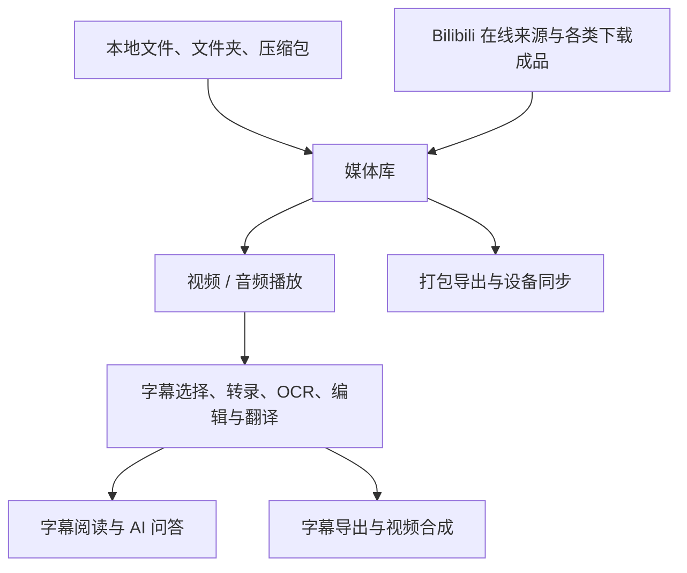

# Fluent Player 使用手册

[项目首页](../README.md) · [安装与升级](installation.md)

## 快速上手

先从本地播放开始即可，下载、识别、AI 与同步功能可以按需使用。

### 播放第一份本地内容

1. 在媒体库展开操作按钮，选择 **导入视频或音频**。
2. 选择文件；也可按平台使用相册、文件夹或压缩包导入。桌面端还可以把文件和文件夹拖进媒体库。
3. 点击媒体卡片开始播放。播放位置会被记录，下次打开可以继续。
4. 有字幕时，打开 **字幕库** 选择主字幕；需要双语显示时再选择副字幕。
5. 打开 **字幕边栏**，一边播放一边阅读，点击字幕可跳到对应位置。

想整理一整套课程，可以先新建合集，再在合集内导入。合集在软件中表现为文件夹，后续播放、批量处理与同步都能围绕它进行。

### 观看 Bilibili 内容

1. 在媒体库的 **哔哩哔哩** 入口浏览或搜索视频，也可以在导入菜单选择 **导入 Bilibili 链接**。
2. 浏览结果可直接打开播放；通过链接解析导入时，按提示先登录 Bilibili。多分 P 或剧集内容可选择对应条目。
3. 想让内容长期出现在自己的文件夹中，使用 **导入** 创建在线播放卡片。
4. 想离线观看，进入 **B站下载**，解析链接、选择任务并下载，完成后导入媒体库。

**在线播放卡片保存的是来源信息，下载任务保存的是本地媒体文件。** 前者仍需要网络与有效访问权限。

### 用字幕辅助学习

1. 先为视频准备可读字幕：选择已有字幕、导入字幕文件，或根据内容使用语音转录 / OCR。
2. 将原文设为主字幕，将译文设为副字幕，调整字号与位置。
3. 使用字幕边栏逐句跳转，或切换文章模式连续阅读；选中文字可以复制整理。
4. 需要解释和总结时打开 **AI 对话**，配置自己的模型连接后提问。
5. 字幕整理完成后，可以导出字幕文件，或通过 **合成视频** 输出带字幕的视频。

## 先理解几个概念

| 概念 | 含义 | 对日常使用的影响 |
| --- | --- | --- |
| 媒体库卡片 | 软件记录的一条媒体信息，包含标题、封面、来源、字幕和播放位置等 | 卡片既可以对应本地文件，也可以对应在线播放来源 |
| 文件夹 / 合集 | 媒体库内部的层级组织 | 库内改名或移动通常只整理媒体库，不等于改名、移动磁盘上的原文件 |
| 本地导入 | 将文件登记到媒体库；可按设置复制到应用私有存储 | 只引用原路径时，原文件被移动或删除会影响播放 |
| 在线导入 | 保存在线来源，播放时获取实际媒体地址 | 不等于已下载，清晰度和可访问性受来源网站及账号影响 |
| 在线缓存 | 为播放或后续处理临时保存的数据 | 缓存可被清理，不应当作独立备份；需要离线保存时使用下载与导出 |
| 主字幕 / 副字幕 | 同时显示的两条字幕轨，常用于原文与译文 | 切换显示轨道不等于删除字幕文件，同一媒体可以保留多个字幕版本 |
| 打包、导出与同步 | 分别用于保存可导回的数据包、生成通用文件、持续交换设备间的变化 | 三种方式可配合使用，选择方法见[合成与导出](#合成与导出)与[设备同步](#设备同步) |

主要使用路径如下：

## 媒体库与文件管理

### 四个入口，各自解决不同问题

| 入口 | 适合做什么 |
| --- | --- |
| **继续学习** | 找到真正开始看过、仍待继续的内容；也可将需要反复使用的媒体或文件夹置顶 |
| **最近添加** | 按导入活动找回刚加入的内容，适合导入后集中检查和整理 |
| **文件夹** | 查看自己的完整媒体组织结构，进入合集、移动内容、管理层级 |
| **哔哩哔哩** | 浏览和搜索线上内容，与自己的本地媒体库衔接 |

入口顺序可以调整，也可以设置启动时打开哪个入口、是否恢复上次页面。

“继续学习”会结合实际观看时长判断是否展示，默认需观看达到 **30 秒与片长 20% 中较小的值**，且尚未完成。可以调整观看门槛、播放进度、剩余时长、短视频和时间范围等条件。仅把进度条拖到中间，不等于已经实际观看。

### 导入单个文件，也能整理整套内容

- **文件与相册**：选择一个或多个视频、音频；移动端可从系统相册导入。
- **文件夹**：扫描媒体与子目录，预览后选择需要的内容并保留层级。当前 iOS 导入菜单不提供普通文件夹选择入口。
- **压缩包**：导入 ZIP、TAR 及 gzip / bzip2 / xz 对应的压缩包，按目录结构整理其中的媒体与字幕。
- **批量导入媒体及对应字幕**：分别加入媒体和字幕，独立拖动两列，使同一行相互对应，再逐行确认关联并导入。目标位置按导入设置决定，适合大量课程与字幕文件。
- **拖放与系统打开**：桌面支持拖放；Android / iOS 接入系统分享或打开文件流程，具体可选类型取决于系统。
- **FluentPack**：导入从本软件导出的数据包，恢复包内媒体及其组织信息。

本地导入可选择是否复制到应用私有存储。引用原文件节省额外占用；复制后由应用保存副本，更适合需要长期保留的内容。下载、压缩包解压和数据包导入也可能生成应用管理的文件。

还可以设置新卡片进入当前文件夹、媒体库根目录，或按来源功能分别归档，便于集中整理不同渠道加入的内容。

### 查找、选择与整理

媒体库支持列表与卡片视图、标题搜索、多层文件夹、路径导航、重命名、封面设置、拖拽排序和移动。桌面可框选，触摸设备可长按进入选择并连续选择；多选后统一移动或移入回收站。

搜索按媒体库条目自身的标题匹配，不区分大小写。搜索帮助你定位媒体，开始播放后的上一项 / 下一项沿用原文件夹顺序；它不搜索字幕全文或磁盘路径。

在“继续学习”或“最近添加”中选择 **从本页移除**，只影响对应视图中的展示，不删除原文件。置顶内容的排序也不会移动它在媒体库中的原始位置。

从“继续学习”移除后，主动重新观看并达到门槛可再次出现；从“最近添加”移除后可以即时撤销，后续播放不会自动恢复。

### 回收站与源文件恢复

移入回收站后，可以恢复条目；永久删除会清理卡片及应用管理的相关文件。仅引用的外部原文件会保留，需要时可通过系统文件管理器删除。

若原文件换了位置，播放页可使用 **重新定位文件**，将原卡片接回新的本地文件，继续沿用字幕与观看记录。此功能用于本地来源，不适用于把在线卡片改成本地文件。

## 视频播放与音乐歌词

支持多种常见媒体格式，例如：

| 类型 | 常见格式 |
| --- | --- |
| 视频 | MP4、MKV、MOV、AVI、WebM、FLV、TS、M2TS、WMV 等 |
| 音频 | MP3、M4A、FLAC、WAV、AAC、OGG、Opus、AIFF、APE 等 |

可导入的扩展名与实际解码能力是两个层面，具体播放表现还取决于文件编码、平台和设备。

### 围绕连续观看设计的播放控制

- **续播与队列**：记录播放位置，支持选集、上一项 / 下一项、自动连播与列表循环；进入页面、切集和播完后的自动播放可分别设置。
- **倍速**：提供多档与自定义倍速，也可以锁定全局倍速；长按画面或按住右方向键可临时加速，松开恢复。
- **定位**：拖动进度条、双击快进 / 快退或跳转上一句 / 下一句字幕、章节导航与当前章节循环；可用时显示缩略图预览。
- **画面**：调整宽高比、缩放、旋转与位置，按需还原画面；支持全屏与控件锁定。
- **音量与亮度**：按设备使用手势、控件或物理键盘调整。
- **弹幕**：播放 Bilibili 弹幕或已关联的弹幕文件，并调整显示样式。
- **播放表现**：提供硬件优先 / 软件解码等设置；具体解码策略按平台适配，Linux 当前使用软件视频解码路径。
- **横竖屏**：手机提供竖屏播放与横屏播放界面；桌面使用窗口和侧栏，平板按屏幕空间适配。

退出播放页后，可以通过媒体库中的迷你播放卡片继续控制当前内容。移动端还接入系统媒体控制，按平台与设置支持通知栏、锁屏或耳机操作。

本地内容、Bilibili 在线视频和网盘媒体共用队列的播放结束处理。确认播完后保存完成状态和从头重播的书签；短暂重播只更新这次的续播位置。在线流临时上报明显偏短的时长不会单独触发连播。网盘队列到达当前已加载的末尾时，先读取后续条目，再判断队列结束或列表循环；在等待期间暂停、停止或另选媒体，会取消原来的自动切集。返回前台不会重播已经结束、仍在等待下一集的媒体。

普通视频本次重播达到“继续学习”的有效观看门槛后，会按原有规则重新进入未看完内容；播客的“已听”标记独立保留。

弹幕可以独立开关；在弹幕设置中切换“竖屏播放页 / 横屏播放页”，分别调整字号、显示区域、速度和密度（10%–100%）。竖屏默认按手机屏幕适配字号，使用上方 25% 区域、50% 密度，普通滚动弹幕在 1 倍播放下约 10 秒穿屏。播放时把源轨道分配到当前可用行，滚动、置顶和置底可以互相叠加；只对同类型弹幕做短时入场防挤，不会为避免未来可能追尾而大量过滤。高级设置默认思源黑体、700 字重，已有手动字体选择继续保留。不透明度、字体、描边等共用设置仍可调整，也可限制在视频画面内展示。详见[弹幕渲染说明](danmaku-rendering.md)。

### 定时暂停与后台行为

**定时关闭** 提供倒计时、累计实际播放时长、指定时间、当前内容结束、队列结束或再播放若干项后暂停等方式。这里的结束动作是暂停媒体。

还可以分别设置 **退出页面后自动暂停**、**离开软件后暂停播放**。需要后台听音频时，应同时检查这些选项及系统对后台应用的限制。Bilibili 内容也有后台仅音频的省流量设置。

### 音频播放与沉浸式歌词

音频可以使用同一套媒体库、播放队列与字幕系统。普通播放页还提供实验性的沉浸式音乐界面：**双击播放页标题进入**，可查看封面、同步歌词并控制播放。

音乐界面的 **搜索歌词** 会结合歌名、歌手与时长，从网易云音乐、QQ 音乐和 LRCLIB 查询候选。你可以修改查询词、从文件名选词、预览不同版本，再将原文与可选译文应用为主副字幕。

有来源数据时支持逐字歌词；没有逐字时间就按逐句歌词显示。可用毫秒偏移修正对齐。匹配到的歌名相同不代表录音版本相同，现场版、翻唱或剪辑版需要预览确认。更多说明见[歌词搜索](lyric-search.md)。

## 字幕工作流

字幕贯穿播放、阅读、编辑、翻译、AI 问答和视频导出。建议先准备准确的文本与时间轴，再调整显示样式，最后决定是否导出或合成。

### 选择适合的字幕来源

| 手头有什么 | 使用方式 | 需要了解 |
| --- | --- | --- |
| 外挂字幕文件 | 在字幕库导入或选择；同目录字幕可自动发现与匹配 | 支持 SRT、VTT、ASS / SSA、LRC 等文本字幕 |
| 视频内嵌字幕 | 探测并提取内嵌字幕轨，再选择使用 | 字幕轨可能是文本，也可能是位图 |
| Bilibili 字幕 | 从当前视频可用字幕轨中选择 | 是否有字幕、有哪些语言取决于视频与访问状态 |
| 有人声、没有文字字幕 | 使用 **语音转录** 或 **语音转录队列** | 在模型中心选择公益接口、本地模型或已配置的转录服务 |
| 字幕已经烧在画面里 | 使用 **OCR 字幕** 框选字幕区域 | 在本机识别画面文字，生成可编辑的时间轴字幕 |
| 只有原文，想要译文 | 使用字幕翻译，保留原文并生成译文版本 | 联网翻译或使用自己的 AI 连接 |

PGS / SUP 等位图字幕可以按相应路径加载显示，但图片本身不等于可搜索、可翻译的文字。需要处理文字时应先获得文本字幕。

### 字幕库与双语显示

同一个媒体可以保留外挂、内嵌提取、语音转录、OCR 和翻译得到的多个字幕版本。在字幕库中管理这些来源，再分别选择 **主字幕** 与 **副字幕**，适合原文 / 译文、两种译法或学习材料对照。

可以切换或关闭字幕、调整字幕延迟，并导出字幕。字幕跟随媒体管理，翻译与识别结果也可以继续交给编辑器、边栏和合成工具使用。

字幕库也支持粘贴带时间轴的字幕文本。带逐字时间的歌词或字幕可使用 **从词级文件导入**，包括 TTML、DFXP、YRC、QRC、KRC 等格式；逐字显示依赖源文件已有的时间信息。

### 字幕编辑与翻译

字幕编辑器支持逐句修改文字、删除行、撤销 / 重做、前后句跳转与自动跟随，修改会实时保存。还可以从当前字幕复制出新的分组并重命名，保留不同整理版本。

编辑结果保存为 SRT；处理外部字幕或其他格式时，会按需要生成与媒体关联的编辑副本。字幕整体偏早或偏晚可通过同步偏移调整。当前编辑器侧重文字校正，不提供专业时间轴软件的逐条时间戳编辑、合并与拆分工具。

字幕翻译提供多个在线引擎，也支持使用已配置的 AI 连接；手动模式可以复制提示词到自己的工具，完成后回贴结果。翻译完成后将原文与译文分别设为主、副轨即可双语显示。服务是否需要密钥、可用语言及调用限制，以所选引擎为准。

### 样式与字幕位置

字幕可调整字体、字号、颜色、描边、阴影、背景、行距和布局，并按主副字幕、横竖屏及音频场景设置显示方式。内置多种字体与样式预设；开启 **连续字幕** 后，字幕间隙会继续显示上一句，直到下一句开始，便于反复阅读。

普通视频字幕按实际画面短边等比例缩放，横竖屏和精确合成共用排版规则；可用「整体大小」调整主副字幕。幽灵字幕按完整窗口自动保持阅读大小，侧栏开合不改变字号，也不影响成片。字幕通常在区域宽度的 86% 内换行，超宽窗口还会限制行长；中英日韩等语言优先按标点和自然边界断行，适度均衡行长，主副字幕独立排版并保留源字幕已有换行，详见[多语言换行说明](subtitle-wrapping.md)。原「自适应屏幕字号」开关已整合为上述固定规则。

**移动字幕** 提供直接拖动、对齐与吸附，便于避开画面中的人物、图表或原有硬字幕。还可设置播放控件出现时自动避让底部操作区域。

### 字幕边栏与文章阅读

- **列表模式**：按时间轴查看字幕，跟随当前播放位置，点击条目定位播放。
- **文章模式**：将字幕组织成连续文稿，适合阅读长课程、演讲或访谈。
- **选取与复制**：选择需要的文字，配置字幕之间的空格、换行、自定义分隔，以及双语文字的排列。
- **结合 AI**：从播放页或字幕侧栏切换到问答，围绕同一媒体的可读字幕继续理解内容。

### 语音转录

**语音转录** 支持公益接口、本地模型和自定义转录服务，可在模型中心选择。批量字幕页面可以集中添加库内媒体或外部文件，管理开始、暂停与完成的任务。

云端转录支持 ElevenLabs、Soniox、AssemblyAI、Deepgram 和 Google Gemini。在“媒体库设置 → 模型中心 → 服务管理”填写自己的 API Key，选择模型及语言即可直接上传音频，无需准备存储或链接。默认自动识别语言、保存词级时间信息；说话人和术语按模型能力显示，默认关闭。模型列表会更新并保留当前选择，高级设置也可填写新的模型 ID。长音频自动分段，完成部分按顺序显示并保存；详情见[云端转录](cloud-transcription.md)。

公益接口按每 30 分钟切分音频，各段首尾相接，不额外重叠或合并长尾段。当前片段上传或等待识别时，会提前准备至多一个后续片段，减少准备音频的等待；接口任务仍按顺序提交并保留段间等待。暂停、失败重试及更新前已经提交的任务会继续复用原有进度。固定切点可能落在词句中间。

外部文件可选择字幕输出位置，并可在识别后内嵌软字幕。输出设置还提供替换原视频或内嵌后删除 SRT 的选项，启用时需明确希望保留哪些文件。失败或中断的转录可重试，已经完成的识别分段会继续复用。

无音轨、静音片段或无法辨认的人声可能没有识别结果，准确度也受口音、噪声和混音影响。

### 本地 OCR 提取硬字幕

OCR 用于把视频画面里的文字变成字幕：

1. 打开视频的 **OCR 字幕** 工具，预览画面并框选字幕区域。
2. 按需要建立多个识别区域，选择语言、识别参数以及全片或自选时间范围。
3. 开始任务，软件抽帧、识别并合并重复文字及时间段。
4. 完成后，结果自动保存为 SRT 并关联到字幕库；面板会将前两条应用为主副字幕，可继续编辑或导出。

顶栏右侧可勾选 **处理时不息屏**（窄屏显示“亮屏”，空间更小时保留勾选图标），默认开启并记住选择。Android、iOS、macOS、Windows 和 Linux 共用此设置；仅在 OCR 任务运行期间保持亮屏，包含任务所需的模型下载、素材准备、识别和保存，完成、取消或失败后自动释放。Android / iOS 仅在应用可见时生效，切到后台后释放，返回时若任务仍在运行则恢复；桌面端在处理期间切换窗口或最小化仍保持请求。关闭 OCR 面板不会终止任务或提前释放。播放视频本来就有前台防息屏；OCR 结束后若视频仍在播放，播放本身仍会保持亮屏。Linux 的实际效果取决于桌面环境是否提供屏保抑制接口；此选项不保证移动端后台运行或阻止手动锁屏。

项目内置 PaddleOCR 的 ONNX 模型，覆盖中文、英文、日文、韩文及拉丁字母语言，在本地执行识别。多区域可分别输出字幕。识别质量取决于画面清晰度、文字大小、背景和区域选择；OCR 读取的是画面文字，语音转录读取的是声音。

## AI 视频问答

AI 对话把当前媒体的字幕文稿与视频信息作为资料，用于解释概念、总结内容、查找论据和多轮追问。它与字幕转录是独立功能，需要先配置自己的模型连接。

### 连接自己的模型

| 连接方式 | 适用场景 | 准备工作 |
| --- | --- | --- |
| API | 使用远程服务或本地模型服务；适用于桌面与移动端 | 选择 OpenAI 兼容、Claude 原生或 Gemini 原生协议，填写相应地址、模型与凭据 |
| 桌面 CLI | 复用本机 Codex / OpenCode 的现有环境 | 在 Windows、macOS 或 Linux 安装并配置相应工具，再在软件中连接 |

播放器不会随附这些大模型。服务地址、模型能力与可用参数需要相互匹配，调用费用和账号限制由所连接的服务决定。

### 围绕当前媒体提问

1. 在播放页点击 **AI 对话**，或使用实体键盘按 `W` 打开。
2. 打开 **视频资料**，检查已读取的字幕，按需要选择作为资料的文稿。
3. 输入问题，例如“按章节总结这节课”“解释这里的术语”“给出支持这个观点的原文位置”。
4. 阅读流式回答；回答中的有效时间戳可以点击跳回播放位置，方便核对。
5. 继续追问，或新建另一份对话。每份对话保留自己的历史与输入草稿。

资料可以来自当前主副字幕、关联文本字幕、同目录候选字幕及可用的 Bilibili 字幕，并结合标题、时长、章节等信息。在 AI 的“视频资料”中选择文稿，不会改变播放器正在显示的字幕轨。

**打开 AI 对话不会自动执行转录或 OCR。** 没有可读文稿时，只能依据已有媒体信息回答。当前问答主要理解文字资料；画面中有文字但没有文本字幕时，应先 OCR，有声音但无字幕时可先转录。

### 长文稿与多轮对话

支持自动处理文稿、全文直读、检索相关片段以节省 token，以及分段整理后复用结果。你也可以调整上下文预算、单次生成上限及模型支持的思考参数，查看上下文与用量，手动或自动压缩较长的对话历史。

全文模式需要足够的上下文容量；片段检索模式可能不覆盖全片细节。模型回答仍应结合字幕与时间戳核对。上下文压缩会调用当前模型，也可能产生额外用量。

对话支持停止与继续生成、编辑提问、历史搜索、重命名、删除、Markdown 复制与全屏阅读。本地保存历史不意味着推理离线：发起请求时，问题与选入的资料会交给你配置的模型服务。

## Bilibili

### 浏览、搜索与观看

媒体库的 **哔哩哔哩** 入口提供视频与用户搜索，可输入关键词、BV 号或视频链接。支持搜索建议、搜索历史，以及按播放量、发布时间等条件排序和按时长等条件筛选。

顶部收藏夹按钮和账号页的 **B 站收藏夹** 可查看当前登录账号的收藏夹及夹内视频，支持分页、顶部刷新和下拉刷新。列表、封面、播放和导入沿用其他 B 站子页面的行为；下载继续从原有入口操作。收藏刷新只更新浏览列表，B 站移除收藏不会删除本地已导入卡片或下载文件，软件也不会新增、移除收藏或编辑 B 站收藏夹。

收藏夹行和夹内顶部的 **导入** 可整夹导入默认位置，旁边的文件夹按钮可指定位置，目标位置会创建以收藏夹命名的目录。夹内右上角的 **多选** 或长按视频可批量勾选；**全选** 包含尚未加载的全部分页。底栏可导入默认位置或统一选择一次目标位置，多选导入不添加收藏夹外层目录。两种批量操作均导入全部分P，跳过已失效及非视频内容；失败项保留供重试。多选期间暂停刷新，返回键先退出多选。

进入 UP 主页面可以浏览投稿、搜索其视频、查看合集与系列；专栏通过外部网页打开。搜索结果、UP 主内容、合集和观看历史中的视频都可以直接播放。

播放器内的 Bilibili 面板把视频简介、UP 主、统计信息、分 P、合集和相关操作放在一起。播放时可切换实际可用的清晰度，使用来源提供的字幕、弹幕、章节及进度预览。

### 账号与历史

支持官方网页登录、二维码登录与 Cookie 登录，可管理登录状态并退出。需要账号权限的画质、视频和字幕，仍取决于自己的 Bilibili 账号与网站返回结果。

B站下载与链接解析导入页需要先登录；公开内容的搜索浏览与直接播放则按视频权限决定。

- **账号仅用于读取内容**：软件内不提供点赞、投币、收藏、关注等账号操作，也没有只读模式开关；需要互动时可用页面上的按钮在哔哩哔哩或浏览器中打开。
- **播放时自动导入媒体库默认关闭**：直接浏览观看不会自动生成库内卡片；需要时可手动导入，或开启自动导入。
- **搜索历史与观看历史**：可以分别关闭、清空；观看历史帮助你找回没有导入媒体库的内容。

登录后，启动应用或返回前台时可识别剪贴板中的 Bilibili 链接，并选择直接播放、添加在线播放卡片或导入下载页；可以设置相同内容只识别一次。

### 在线导入与本地下载

| 方式 | 保存内容 | 适合场景 |
| --- | --- | --- |
| **导入 Bilibili 链接 / 在线导入** | 在线身份、标题、封面及可用字幕和章节等信息 | 把线上课程整理进自己的文件夹，随时联网播放 |
| **B站下载** | 实际媒体文件，以及按设置下载的字幕和弹幕 | 离线观看，或保存到本地后处理 |

支持 BV、av、视频 / 番剧链接、`ep` / `ss` 与 `b23.tv` 短链接，也可粘贴包含链接的分享文字。多分 P 或合集内容可以选择需要的条目，并指定导入位置。

**下载流程**：进入 B站下载 → 登录 Bilibili → 粘贴并解析 → 选择条目、清晰度、编码与字幕 → 下载并合并 → 导入媒体库。可设置首选清晰度、字幕语言、弹幕、并发、自动入库及入库后移除任务记录；任务支持暂停继续和调整处理顺序。

下载页还可 **双击标题** 在下载与在线导入模式之间切换。在线导入不提前固定下载画质，实际播放时再获取可用清晰度。

对在线卡片运行语音转录、OCR 或合成时，软件会按任务需要准备本地音频、画面或完整媒体，并尽量复用已准备的素材。因此“在线播放不先下载全片”与“后处理需要本地素材”可以同时成立。

## 网页媒体与其他站点

### YT-DLP 下载

**YT-DLP 下载** 用于 YouTube 及其他 yt-dlp 能解析的网站，支持从多行输入或一整段分享文本中提取链接。

使用流程为 **粘贴链接 → 解析任务 → 选择媒体流与字幕 → 开始下载 → 导入媒体库**。每个任务可以选择视频流、需要时的独立音频流以及多条字幕；当前视频输出容器为 MKV。

任务列表提供批量开始、插队、暂停、取消、重试、移除和导出到媒体库，并显示进度、速度、失败原因及输出位置。可以设置首选清晰度、字幕语言偏好、分片并发和自动入库，查看下载组件的环境与版本，并在支持的平台更新组件。

Windows、macOS 和 Linux 可在下载设置中手动输入“同时下载任务数”（正整数，默认 1，无预设上限）。调高会启动排队任务；调低后正在执行的任务继续完成，后续任务按新上限启动。分片并发数对每个任务独立生效，例如两个任务各设 16 时，每个任务仍使用 16，不会在任务之间分摊。Android 和 iOS 仍一次执行一个任务。

字幕选择包括解析器直接提供的自带字幕与自动生成字幕，多语言可同时下载。这里不会列出 YouTube 网页上的全部自动翻译语言。

需要登录的网站，可在 **YT-DLP 下载设置** 中连续点击标题 **5 次** 展开高级设置，再选择并启用 Cookie 文件。Cookie 有效期与可用格式由来源网站决定。

### 抖音下载

独立的 **抖音下载** 入口位于导入菜单中。粘贴分享文案、视频、主页或合集链接，点击 **解析并加入队列**。多条链接使用 **批量添加**，每批最多 100 条，自动去重并顺序处理。

1. 提交链接，解析成功的普通视频会直接进入下载队列，默认选择最高可用画质。
2. 需要登录或验证时点击 **网页处理**，完成后继续解析剩余链接。
3. 在队列中调整画质，再点击 **开始下载**；加入队列不会立即传输文件。
4. 完成后自动导入媒体库，失败可重试；地址失效时点击 **重新解析**。

**下载设置 → 手动网页嗅探** 可切换到自行浏览、查看资源和手动入队的方式。当前支持普通视频，不包含图集与直播；主页和合集每次最多解析 100 个网页已加载视频，下载时需要保持应用运行。

### 从网页发现音视频

进入 **导入视频或音频 → 从网页发现音视频**，打开“浏览器导入”。在地址栏输入网址后，像普通浏览器一样访问页面并播放内容。

- **浏览**：前进 / 后退、刷新、全屏、桌面模式、网站快捷入口、历史记录与保留的浏览会话。桌面模式在手机、平板和电脑上均默认开启；可在“浏览器菜单”中勾选或取消“桌面模式”，并记住你的选择。
- **发现**：捕获页面中的可用视频、音频与字幕，在资源列表查看或预览。
- **下载**：使用网页播放器旁的 **下载此视频 / 下载此音频**，或从资源列表加入队列；自动下载流程会匹配需要的媒体与音轨，在资源准备好后开始下载并入库。
- **队列**：支持并行下载、单任务与批量暂停 / 继续、失败重试、调整等待顺序及重命名。队列窗口打开时仍可操作窗口外的网页；拖动标题栏移动、拖动右下角调整大小，点击右上角 × 关闭。列表展示平滑速度与下载进度，展开可查看真实分块、连接状态和速度曲线；诊断信息按需打开。成功入库后可点击 **立即播放**。
- **队列设置**：右上角齿轮可设置自动开始（默认开启）、并行任务数（默认 3）、每任务最大连接数（默认 32）、全局限速、重试次数及重启后继续。修改即时生效并自动保存；已有连接数选择继续保留。降低并行数会保留进度，让多余任务回到排队。
- **连接分配**：队列共享最多 32 条并行数据连接，按实际请求动态分配，单任务可借用全部空闲额度。多个任务竞争时优先补给当前获得连接较少的任务；普通文件在最多 1 MiB 的校验字节窗口之间交还额度，HLS/DASH 在分片之间交还，避免反复中断正在写入的数据。小文件、单连接服务器及站点限流会降低实际连接数。
- **任务网络**：任务操作菜单或展开详情中的“网络”可单独选择跟随软件设置、直连、设备代理或自定义代理，选择会随任务保存。默认跟随软件网络设置的“其他联网功能”；任务覆盖策略适用于页面后台解析、清单、密钥、媒体及字幕，网页浏览仍使用原有浏览器网络策略。代理地址和密码统一在软件网络设置管理，不写入任务快照；切换任务网络会保存断点并重新连接，其他任务继续下载。直连表示绕过应用代理和系统 HTTP/SOCKS 代理，不改变系统 VPN/TUN 路由。
- **Cookie**：按网站查看、搜索、添加、编辑、导入请求头或清理 Cookie；值默认隐藏。

支持普通视频 / 音频直链，以及可处理的 HLS / M3U8、DASH / MPD 点播资源；需要时合并独立音视频。发现到可用字幕时可以选择主副字幕，下载入库时也会尝试保留相应字幕文件。

暂停和重启会保留可用断点、已完成分片与音视频文件。默认重启后等待手动继续；链接失效时可能需要返回原网页更新资源。移除未完成任务会清理其下载残留，清除完成记录保留媒体库文件。移动端被系统挂起时沿用应用现有恢复机制，不提供独立的系统后台下载服务。

网页预览与正式入库是两个阶段。要使用完整的媒体库管理、语音转录与 OCR，先下载入库。Windows 使用 WebView2；Linux 在专用 Chrome / Chromium 窗口中打开网页，下载仍由应用管理。

网页资源是否可发现、是否完整，以及下载能否继续，取决于网站与资源类型。普通直链满足服务器条件时可以续传，HLS / DASH 或分离音视频任务暂停后可能重新下载。当前网页下载不支持直播、DRM 保护内容及多时段 DASH 清单。

## 合成与导出

### 将字幕放进视频

在播放页打开 **合成视频**，选择主副字幕、显示样式、位置、输出分辨率与保存目录，加入合成队列，再查看进度与结果。

| 输出方式 | 结果 | 如何选择 |
| --- | --- | --- |
| **烧录字幕** | 字幕成为画面的一部分，其他播放器也能直接看到 | 需要固定展示效果，或准备分享带字幕的视频 |
| **额外内嵌软字幕** | 视频中附带可切换的字幕轨，可与烧录同时使用 | 想让接收方同时保留字幕选择能力 |
| **仅合成软字幕** | 保留可开关的字幕轨，不把字幕写进画面 | 想保留干净画面；可按选项保持源画质并只做封装 |

烧录可选择 **精确渲染** 或 **粗略渲染**：前者更侧重还原应用中的字幕样式，后者使用较轻的字幕渲染路径。具体耗时受视频分辨率、时长、字幕样式和设备性能影响。

合成是字幕烧录与封装工作流。输出前可以预览，并保留原媒体用于继续编辑；不要把未完成的队列记录当作已经生成的成品。

合成队列支持单项删除、**批量选择**与**清空队列**。批量选择后可勾选任务或全选，再点击**删除已选**。确认窗口中按主键盘或小键盘 **Enter** 确认，按 **Esc** 取消；可选择是否同时删除已合成的视频，并记住该选择。删除中的运行和排队任务会取消，文件删除失败时保留对应记录，方便解除占用或授权后重试。

成片预览结束后会返回原来的播放器或队列，保留原视频的进度及播放/暂停状态。预览加载中也可以返回；预览沿用当前页面的横竖屏与系统栏状态。

### FluentPack 与 ZIP 怎么选

在媒体库打开 **导入与导出**，选择媒体或文件夹，再选择格式与导出选项。

| 格式 | 用途 | 保留什么 |
| --- | --- | --- |
| **FluentPack（`.fluentpack`）** | 迁移到另一份 Fluent Player，或保存一组可导回的内容 | 所选媒体、必要文件夹层级、标题、封面、字幕关联、播放位置等媒体信息 |
| **ZIP** | 交给其他播放器，或按整理好的名称取出通用文件 | 本地媒体与必要层级，可选外挂 / 内嵌软字幕与 ASS 弹幕，并按需要保留封面与章节 |

FluentPack 可以设置包名、压缩策略、最外层文件夹、字幕与附属文件、完整性校验。开启「包含字幕与附属文件」时，原始字幕、弹幕、已管理字幕及逐词时间文件随包保留，导入后恢复主副字幕关联和来源信息。如果已关联的字幕或弹幕文件缺失，FluentPack 和 ZIP 的任务结果都会明确提示未打包的附件数量。数据包不包含整个应用的账号、设置、置顶状态和完整观看历史。

ZIP 按媒体库卡片标题命名，同层重名自动区分；字幕与弹幕可按选项内嵌或外挂，新导出默认开启软字幕内嵌和包含弹幕，之前明确保存的开关选择仍会保留。ASS 字幕和弹幕采用 MKV 容器保留样式与滚动指令，纯音频需要同类封装时使用 MKA；在其他播放器中需要选择弹幕字幕轨，多数播放器一次只显示一条轨道。无法内嵌时保留原媒体和外挂字幕，并在任务结果中说明。重新封装不重新编码视频或音频，但仍可能需要接近所处理媒体体积的临时空间。

| 来源 | FluentPack | ZIP |
| --- | --- | --- |
| 哔哩哔哩下载页下载并导入的视频 | 始终携带关联的本地下载文件，不受在线缓存开关影响；文件已丢失时明确提示 | 导出本地下载或可用完整缓存 |
| 哔哩哔哩在线卡片 | 「携带哔哩哔哩在线缓存」默认开启：携带一份已有完整缓存和画质信息；关闭或没有缓存时保留来源及所选附件 | 导出已有完整缓存；没有完整缓存的在线卡片会跳过并显示数量 |
| 网盘视频、音频 | 导出完整本地文件或完整缓存，导回后保留网盘来源和离线媒体 | 导出完整本地文件或完整缓存 |
| 播客频道、单集卡片 | 迁移卡片、订阅或单集来源、播放信息，不携带节目媒体；单独选择一集不会打包其他集的下载 | 保存卡片资料和可打开的订阅链接，可由本软件重新导入；不携带节目媒体 |

网盘媒体尚未完成缓存时，导出会提示选择实际可用的缓存画质，沿用现有缓存任务，完成后点击「检查缓存并继续」。导出不自动下载，也不会将播放分片、单独视频轨、单独音轨、失效文件或旧修订缓存当作完整离线媒体。多画质缓存按现有排序选取一份完整版本；FluentPack 优先携带哔哩哔哩卡片关联的原下载文件，ZIP 按原画、最高可用画质选择，不会把所有画质重复打包。导出期间正在使用的缓存受保护，导入后的文件保存在接收设备的永久目录。

这里的「完整」表示已有可独立播放的媒体成品，不表示只来自「缓存」按钮。下载页成品和主动缓存共用存储登记，但保留各卡片的下载来源区别。FluentPack 的在线缓存开关默认开启并记住选择，备份时建议保持开启：原链接失效后，从导回的媒体库卡片仍可播放完整本地副本；关闭后仅有来源和附件的在线卡片依赖原链接。已有离线副本不保证原视频网页仍能打开；手动指定本地没有的画质，也仍需要在线获取。ZIP 直接导出媒体文件，不提供只打包哔哩哔哩链接的开关。

若只需要字幕，可以在字幕库单独导出相应文件，无需打包整个视频。字幕导出保留现有文件格式；它不等于任意字幕格式之间的批量转换。

## 设备同步

设备同步用于在自己的设备之间持续交换媒体库内容与观看进度，**默认关闭**。局域网模式不需要注册本软件账号，也不要求搭建专用服务器。

### 第一次连接

1. 两端连接同一局域网，打开 **媒体库设置 → 设备同步** 并开启自动同步。
2. 找到对方设备，核对两边的确认码，并在两边允许连接；自动发现失败时可手动输入对方地址。
3. 对方还没有内容时，选择 **发送文件夹**，由对方确认接收；接收后加入媒体库并建立后续同步关系。
4. 两端已经有内容时，添加要同步的文件夹，让对方关联对应的本机媒体库文件夹。
5. 正常观看和整理，后续在已关联文件夹的同步按钮中查看状态、立即同步或调整设置。

### 三种同步方式

| 方式 | 媒体与目录变化 | 观看进度 |
| --- | --- | --- |
| **智能双向** | 两端新增和修改互通，补齐缺失媒体 | 双向 |
| **仅同步进度** | 两端各自保留文件与媒体库结构，不自动传媒体 | 双向 |
| **单向跟随** | 以指定来源设备的内容为准，其他设备接收变化 | 双向 |

可进一步设置字幕与附属文件、同步删除、自动接收上限、预留空间、单任务限速和忽略规则。默认不同步删除；需要选择的内容或进度冲突会集中显示，由你决定保留哪一份。

同步作用于 **已经导入媒体库并放入关联文件夹的条目**。它不会持续监控任意系统目录，也不会把库内改名自动变成磁盘文件改名。关联设备离线时，本机仍可观看，重新连接后再交换变化；已打开的播放器不会因为远端进度到来而突然跳转。

哔哩哔哩主动缓存不随设备同步迁移；下载页导入的本地成品照常传送。网盘媒体需先完成缓存，再作为离线媒体迁移，接收后不依赖原网盘登录。新接收文件夹可选择保存到哪个媒体库目录，两端关联根的名称和外部位置各自保留。直传使用加密会话，并检查断点及重试文件的完整性；旧明文直传任务需更新两端后重新发送。

### 可选的 WebDAV / NAS

已有 WebDAV 服务时，可在两端配置同一位置，用它中转加密的观看进度与目录变更记录，便于两端不同时在线时交换记录。

两端仍需先关联文件夹。不在同一局域网时，可在页面右上角导出 / 导入同步码，再选择对应的本机文件夹；同步码包含关联所需的密钥，只交给自己的设备。

**WebDAV 不上传或中转视频、音频与附件。** 缺失的媒体仍需要持有文件的设备在局域网内可达后传输。NAS 需要提供可用的 WebDAV 服务；配置服务不等于自动挂载或扫描 NAS 媒体目录。

局域网传输支持任务状态、暂停 / 重试与中断恢复；保持两端应用打开可减少移动系统的后台中断。访客 Wi-Fi、设备隔离、防火墙或本地网络权限会影响设备互相连接。详细范围、冲突与恢复行为见[设备同步说明](progress-sync.md)。

## 设置与数据管理

### 分功能配置网络

在 **媒体库设置 → 网络设置** 中，可分别为 B站、YT-DLP 国内网站、YT-DLP 国外及其他网站、语音识别、云端转录、字幕翻译、组件更新和其他联网功能选择：

- **跟随设备网络**：使用平台可获取的设备代理配置。
- **不使用系统代理**：不采用系统代理，仍受设备路由和 VPN 等网络环境影响。
- **自定义代理**：使用填写的 HTTP、HTTPS 或 SOCKS5 代理，可配置账号密码。

各功能范围共用一份自定义代理配置，但可以选择不同网络方式。默认 B站、YT-DLP 国内网站与语音识别不使用系统代理，其他范围跟随设备网络。

新增的五家云端转录统一使用“云端转录”，默认跟随设备网络，上传与查询都使用同一范围。公益接口保留原来的“语音识别”设置；页面顶部的整体网络方式仍优先。

YT-DLP 中的 Bilibili 链接使用“B站”设置，其他已识别国内来源使用“YT-DLP 国内网站”设置；通用网页浏览与直接资源下载使用“其他联网功能”设置。

网页组件的独立代理能力还受系统版本影响，例如较旧 Apple 系统的网页仅支持跟随设备网络。某功能联网失败时，先检查它所属范围的设置，详见[网络设置说明](network-settings.md)。

### 了解占用并清理空间

**媒体库设置 → 存储空间管理** 按应用媒体、回收站、下载成品、在线缓存、字幕与弹幕、封面、识别 / 合成工作文件、导出与传输、遗留文件等分类展示占用。可查看路径、关联卡片和大小，搜索文件，按分类清理或复制诊断摘要。

正在播放及被任务引用的文件会受到保护，删除前也会重新检查。移入回收站通常不会立刻释放应用保存的媒体空间，需要永久删除相应文件后才会释放。只引用的外部原文件不作为应用保存的媒体统计和删除。

Bilibili 在线缓存可以设容量上限并单独清理；清理缓存不等于删除正式下载或媒体库卡片。Windows 还提供大文件数据目录迁移，适合把应用管理的大体积数据移动到其他磁盘；Linux 当前可查看和打开数据目录。

### 哪些内容在本机，哪些会联网

| 操作 | 数据流向 |
| --- | --- |
| 本地播放、字幕编辑、本地 OCR、合成 | 主要在设备内处理；在线来源可能先获取所需素材 |
| 在线转录 / 翻译 / AI 问答 | 发送相应音频、字幕、问题与选入资料到所选服务 |
| 在线浏览、下载、歌词搜索 | 向对应来源网站请求内容，可能使用该站登录状态 |
| 设备同步 | 与已配对设备交换关联内容；可选 WebDAV 仅中转加密记录 |

AI 对话历史保存在本地，API 密钥等敏感凭据使用相应的安全存储。网页登录状态与 Cookie 管理有各自的保存与清理入口。导出数据包、分享诊断或复制 Cookie 前，应了解所选内容包含哪些资料。

## 常用快捷键

快捷键随当前页面变化，也可用于手机 / 平板连接的实体键盘。文本输入时字母优先用于输入；输入法组词时不应触发发送等页面操作。桌面全屏快捷键仅在对应平台和界面可用。

| 场景 | 按键 | 功能 |
| --- | --- | --- |
| 桌面全局 | `F11` / `Esc` | 进入 / 退出窗口全屏 |
| 媒体库 | `I` / `N` | 导入媒体 / 新建合集 |
| 媒体库 | `S` / `V` | 搜索 / 切换列表与卡片视图 |
| 媒体库 | `B` / `R` / `X` | 批量选择 / 回收站或移除所选 / 导入与导出 |
| 播放页 | `Space` | 播放 / 暂停 |
| 播放页 | `Esc` | 先关闭选集或工具、逐层返回，再退出窗口全屏；有简介链接浏览记录时返回原视频，最后离开播放页 |
| 播放页 | `←` / `→`，`↑` / `↓` | 快退 / 快进，调节音量 |
| 播放页 | `[` / `]`，或 `Shift+←` / `Shift+→` | 减慢 / 加快一档 |
| 播放页 | `P` / `N` / `G` / `H` | 上一项 / 下一项 / 选集 / 章节 |
| 播放页 | `C` / `L` / `E` | 字幕开关 / 字幕库 / 字幕编辑 |
| 播放页 | `B` / `W` | 字幕边栏 / AI 问答 |
| 播放页 | `T` / `J` | 字幕样式 / 移动字幕 |
| 播放页 | `O` / `V` | OCR 字幕 / 合成视频 |
| 播放页 | `D` / `X` | 弹幕开关 / 弹幕设置 |
| 播放页 | `I` / `Q` | Bilibili 面板 / 在线清晰度 |
| 播放页 | `S` / `Z` | 播放器设置 / 定时关闭 |
| AI 输入框 | `Enter` / `Shift+Enter` | 发送 / 换行 |

按钮悬停提示会显示可用快捷键。其他页面的操作可参考[快捷键对照表](../快捷键对照表.md)，以当前版本的按钮提示与行为为准。

## 常见问题

### 为什么导入了 Bilibili 视频，断网后却不能播放？

在线导入只建立来源卡片。要保存可离线观看的文件，请走 B站下载并确认媒体已下载和入库；播放缓存不等于完整离线副本。

### 明明看过，为什么“继续学习”里没有？

检查实际观看时长是否达到门槛，内容是否已完成，以及该视图的过滤条件。拖动进度不计为实际观看；需要长期保留入口时，可将媒体或文件夹置顶。

### AI 说不了解视频，或回答没有覆盖全片？

先在“视频资料”检查是否有可读字幕。没有时先导入、转录或 OCR；节省 token 的片段模式可能遗漏全片信息，需要全片总结时选择合适的文稿处理方式和上下文容量。

### 字幕在画面上，为什么不能直接复制或翻译？

画面里的硬字幕和位图字幕是图像。硬字幕可用 OCR 从视频画面提取；位图字幕也需要先获得对应文本。可读的文本字幕才能用于选词、翻译与完整文稿问答。

### 网页里能播放，为什么没有发现资源或下载失败？

先实际播放内容，再查看资源列表；需要登录时在对应网页完成登录或验证。部分网站采用受保护媒体、直播、短预览或特殊分段方式，当前解析路径可能无法下载。失败时可查看任务原因、网络范围与诊断信息。

### 文件移动后需要重新导入吗？

本地来源可以先尝试“重新定位文件”，沿用原卡片及关联记录。若希望减少外部路径变化的影响，可为之后的导入开启复制到应用私有存储。

### 换设备应该用 FluentPack、ZIP 还是设备同步？

一次迁移到本软件，使用 FluentPack；希望其他播放器也能使用，选择 ZIP；自己的设备需要持续交换内容与进度，使用设备同步。WebDAV 只中转同步记录，不能代替媒体文件传输。

